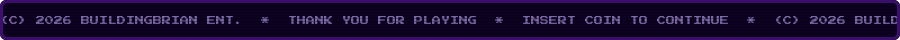

<div align="center">
  <a href="https://github.com/BuildingBrian"></a>
</div>

# Blue Cohort Daily

A class prep podcast for the Berkeley Haas Blue Cohort. Each episode covers one class day: what's due, what
happened last time, what you were meant to read, and what today covers. About twelve minutes, made for the
walk to class.

**Listen:** [Spotify](https://open.spotify.com/show/0f8LvZDJWybFB9FyT4MoGN) ·
[episode page](https://buildingbrian.github.io/blue-cohort-daily/) ·
[RSS feed](https://buildingbrian.github.io/blue-cohort-daily/feed.xml)

To subscribe anywhere else, paste the feed address into Apple Podcasts, Overcast or Pocket Casts:

```
https://buildingbrian.github.io/blue-cohort-daily/feed.xml
```

## How it works

A new episode goes out the evening before each class day, and occasional bonus episodes summarize assigned
readings. This repository is the publishing target, served by GitHub Pages. Spotify and podcast apps read the
feed from here.

| Path | What it is |
|---|---|
| [`index.html`](index.html) | The episode page, with a player for every episode |
| [`feed.xml`](feed.xml) | The podcast RSS feed that Spotify and podcast apps poll |
| [`episodes/`](episodes/) | One MP3 and one metadata file per episode, named by class date |
| [`cover-v2.jpg`](cover-v2.jpg) | Show artwork |

The page, the feed and the episode files are written by an automated publisher, so edits made by hand to
those files are overwritten on the next episode.

Made by Brian Arevalo for the Haas FTMBA Blue Cohort.

<p align="center">
  <a href="https://github.com/BuildingBrian"></a>
  <a href="https://buildingbrian.github.io/BuildingBrian/"></a>
</p>

<div align="center">
  <a href="https://github.com/BuildingBrian"></a>
</div>
